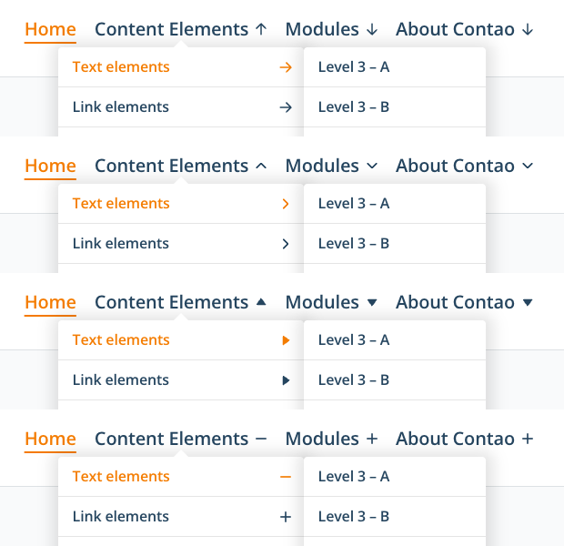

# Contao Custom Navigation

Einstellungen für die Untermenüs des barrierefreien Navigationsmenüs von Contao
(Template `mod_navigation_accessible`) in der Desktop-Ansicht – allen voran ein
**Sicherheitsdreieck**. Eingestellt wird alles direkt im Navigationsmodul.

## Sicherheitsdreieck

Contao schließt ein Untermenü, sobald die Maus seinen Menüpunkt verlässt. Wer schräg
auf das geöffnete Untermenü zufährt, streift dabei oft einen anderen Menüpunkt – und
schon klappt das falsche Untermenü auf.

Mit dem Sicherheitsdreieck bleibt das Untermenü geöffnet, solange die Maus darauf
zufährt. Maßgeblich ist der Kegel zwischen der Mausposition und den Ecken des
Untermenüs: Liegt die Bewegung darin, wartet das Menü; andere Menüpunkte öffnen sich
erst, wenn die Maus den Kegel verlässt oder dort 300 Millisekunden innehält. Die
Richtung spielt keine Rolle – das Dreieck wirkt für Untermenüs unter, rechts und links
neben dem Menüpunkt, also auf allen Ebenen.

## Weitere Einstellungen

* **Nach kurzem Verlassen wieder einblenden:** Verlässt die Maus das Menü, schließt das
  Untermenü sichtbar sofort – samt Symbol und, falls eingestellt, mit Ausblenden. Kehrt
  die Maus innerhalb der eingestellten Zeitspanne zum Menüpunkt oder in den Bereich des
  Untermenüs zurück, öffnet es sich wieder. Wird auf dem Rückweg ein anderer Menüpunkt
  gestreift, wechselt das Menü erst nach 250 Millisekunden Verweilen dorthin.
* **Bei Platzmangel nach links öffnen:** Seitliche Untermenüs ab der dritten Ebene
  öffnen nach rechts. Reicht dafür der Platz im Fenster nicht, öffnen sie nach links –
  wie im Contao-Standard. Das funktioniert auch dann, wenn ein eigenes
  Navigations-Template die Unterlisten in eine zusätzliche Hülle legt (etwa
  `<div class="ul-wrapper">`); Contao selbst misst den Platz in diesem Fall nicht. Ohne
  Häkchen öffnen die Untermenüs immer nach rechts.
* **Ein- und ausblenden:** Untermenüs erscheinen und verschwinden mit einer kurzen
  Überblendung statt schlagartig; die Dauer ist einstellbar. Ein ausblendendes Untermenü
  nimmt keine Mausereignisse mehr an und behält seine Position. Ist im Betriebssystem
  „Bewegung reduzieren“ eingestellt, entfällt die Überblendung. Browser ohne
  `@starting-style` zeigen die Untermenüs wie bisher ohne Übergang.
* **Schatten:** mit oder ohne Schatten unter den Untermenüs; ohne Auswahl („-“) bleibt
  der Schatten des Themes unverändert.
* **Symbol für Untermenüs:** Winkel (Voreinstellung, die Form des Contao-Symbols), Pfeil,
  Dreieck, Plus und Minus oder kein Symbol; wahlweise ersetzt eine eigene SVG-Datei das
  gewählte Symbol. Die Symbole haben die Farbe der Menüpunkte, sitzen mittig zur Zeile,
  zeigen in der ersten Ebene nach unten, in den weiteren Ebenen zur Seite und drehen sich
  beim Öffnen mit; das Plus zieht beim Öffnen seinen senkrechten Strich ein. Öffnet ein
  seitliches Untermenü nach links, zeigt auch das Symbol nach links. „Kein Symbol“
  blendet es nur aus: Mit der Tastatur bleibt der Schalter erreichbar und erscheint mit
  dem Fokus.



## Installation

```bash
composer require heimseiten/contao-custom-navigation-bundle
```

Alternativ über den Contao Manager. Danach die Datenbank aktualisieren
(`vendor/bin/contao-console contao:migrate` bzw. im Contao Manager).

Voraussetzungen: Contao 5.7 oder 6.0 und ein Navigationsmodul mit dem Template
`mod_navigation_accessible` oder einer Variante davon.

## Einstellungen

*Layout ▸ Themes ▸ Frontend-Module ▸ Navigationsmenü*:

| Legende | Einstellung | Voreinstellung |
| --- | --- | --- |
| Bedienung der Untermenüs (Desktop) | Sicherheitsdreieck | an |
| | Bei Platzmangel nach links öffnen | an |
| | Nach kurzem Verlassen wieder einblenden | an, 1000 Millisekunden (100 bis 5000) |
| Darstellung der Untermenüs (Desktop) | Symbol für Untermenüs | Winkel |
| | Schatten | „-“ (unverändert) |
| | Eigenes Symbol (SVG) | aus |
| | Ein- und ausblenden | aus (Dauer 150 Millisekunden, 50 bis 1000) |

Kein Feld lädt das Formular beim Ändern neu: Die Zusatzfelder der Checkboxen blendet
Contao per Ajax ein.

Die Voreinstellungen gelten auch für bereits vorhandene Navigationsmodule. Mit
ausgeschaltetem Sicherheitsdreieck und Wiedereinblenden öffnen und schließen sich die
Untermenüs genau wie ohne die Erweiterung.

Nutzt ein Navigationsmodul ein anderes Template, weist das Backend beim Bearbeiten
darauf hin.

## Wirkungsbereich

* Nur in der Desktop-Ansicht (`body.nav-is-desktop`) und nur bei Bedienung mit der Maus.
  Die mobile Ansicht, Touch und Stift bleiben beim Verhalten von Contao, auch auf
  Geräten, die zusätzlich eine Maus haben.
* Tastatur, Fokus, `Escape` und die ARIA-Attribute behandelt Contao unverändert. Liegt
  der Tastaturfokus in einem Untermenü, greift das Wiedereinblenden nicht.
* Die Einstellungen gelten je Navigationsmodul.

## Technik

Die Erweiterung lässt den Code von Contao unverändert und setzt daneben an:

* **Template:** `mod_navigation_accessible.html.twig` erweitert das Template des Cores
  (``) und ergänzt nur den Wrapper des Moduls um die Klasse
  `custom-navigation` und Datenattribute (`data-nav-dreieck`,
  `data-nav-wiedereinblenden`, `data-nav-richtung`, `data-nav-animation`,
  `data-nav-schatten`, `data-nav-symbol`). Eigene
  Anpassungen im Theme, die dieses Template ebenfalls per `` erweitern,
  bleiben wirksam.
* **Skript:** Contao öffnet und schließt Untermenüs über `mouseenter` und `mouseleave` an
  den Menüpunkten. Das Skript fängt diese Ereignisse am Wrapper ab, bevor sie die
  Menüpunkte erreichen (Capture-Phase), hält sie während des Wartens zurück und holt sie
  danach nach. Contao führt seinen Zustand (`nav-expanded`) damit selbst weiter.
* **Stylesheet und Skript** (komprimiert zusammen rund 9 KB) werden als eigene Dateien mit
  Versionskennung geladen, sobald auf der Seite ein Navigationsmodul mit dem
  barrierefreien Template steht. Es gibt kein Inline-Skript; das `style`-Attribut (Dauer
  der Überblendung, eigenes Symbol) bekommt bei aktiver Content Security Policy einen
  Hash. Ein eigenes SVG wird immer vom eigenen Server geladen, auch wenn für Dateien eine
  Static-URL eingestellt ist: Browser laden CSS-Masken nur mit CORS-Freigabe von fremden
  Hosts.

### Hinweise für Themes

* Mit Sicherheitsdreieck oder Wiedereinblenden macht die Erweiterung geöffnete
  Untermenüs (`nav-expanded`) selbst sichtbar und hält alle anderen verborgen, solange
  sie wartet. Damit funktionieren auch Themes, die Untermenüs nur per `:hover`
  einblenden. Die Anzeige (`display`) selbst bleibt Sache des Themes bzw. des
  Contao-Stylesheets – liegen die Unterlisten in einer zusätzlichen Hülle, braucht es
  dafür wie bisher eine eigene Regel.
* Während die Maus auf ein Untermenü zufährt, trägt dessen Menüpunkt die Klasse
  `nav-gehalten`.
* Die Klasse `nav-ruht` kennzeichnet einen Menüpunkt, der nach dem Verlassen sichtbar
  geschlossen ist, für Contao aber noch geöffnet (Wiedereinblenden). Die Klasse
  `nav-expanded` fehlt ihm in dieser Zeit, damit Untermenü, Symbol und Theme-Regeln wie
  beim Schließen reagieren; den Zustand bei Contao zeigt weiterhin `aria-expanded` am
  Schalter.
* Die Einstellungen zu Überblendung und Schatten haben Vorrang vor dem Theme. Bringt ein
  Theme eigene Übergänge für Untermenüs mit, bleibt „Ein- und ausblenden“ besser aus.
  Der Schatten lässt sich über `--custom-navigation-schatten` anpassen (Standard wie im
  Contao-Stylesheet: `1px 2px 15px 8px rgb(0 0 0 / 10%)`).
* Die Farbe der Symbole kommt aus denselben Variablen wie die Farbe der Menüpunkte im
  Stylesheet von Contao: `--nav-color` und für Hover, Fokus und aktive Punkte
  `--nav-active-color`. Die Erweiterung setzt sie direkt am Symbol, eine Schriftfarbe
  an `.btn-toggle-submenu` spielt dafür keine Rolle. Färbt ein Theme die Menüpunkte nicht
  über diese Variablen, setzt es sie passend, etwa am Navigationsmodul. Im Kontrastmodus
  von Windows erscheinen die Symbole in der Systemfarbe für Schaltflächen.
* In der ersten Ebene reicht die Schaltfläche über die volle Höhe des Menüpunkts; das
  Symbol sitzt damit mittig zur Zeile, solange das Theme dem Menüpunkt oben und unten
  gleich viel Innenabstand gibt (wie das Contao-Stylesheet).
* Die Größe der Symbole lässt sich über `--custom-navigation-symbol-groesse` anpassen
  (Standard `20px`), das Symbol selbst über `--custom-navigation-symbol` (`url(…)`).

## Lizenz

GPL-3.0-or-later
